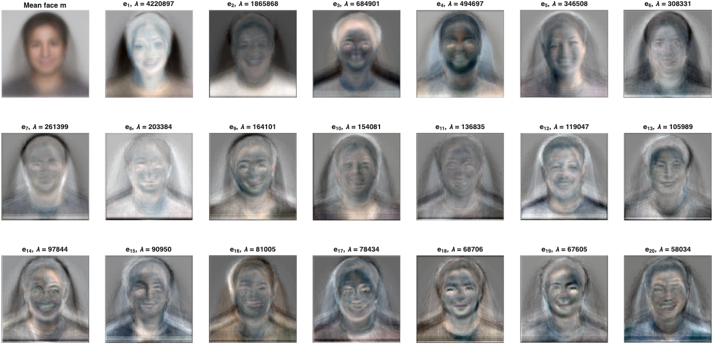
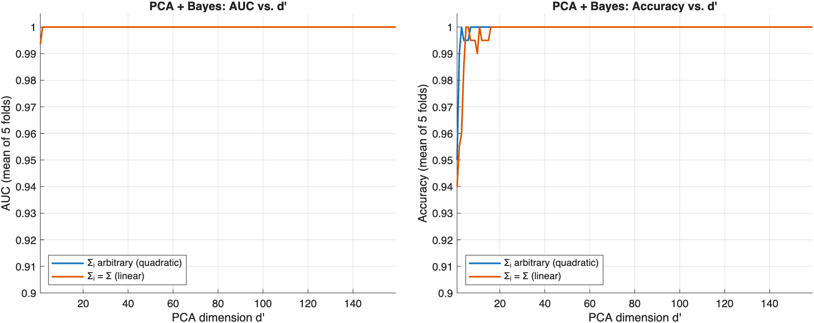
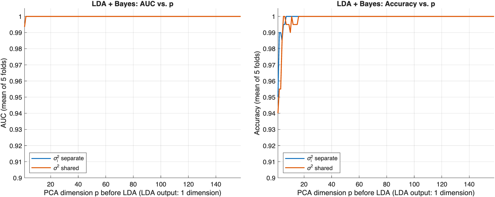

# 性別辨識大挑戰（Gender Recognition Grand Challenge）

圖形識別課程專題：用人臉影像辨識性別，比較不同特徵降維方法與分類器的效能。
程式全部以 MATLAB 撰寫。

## 目前進度

| 週次 | 內容 | 狀態 | 對應程式 |
|---|---|---|---|
| 第四週 | 計算男性、女性影像的平均向量 | 完成 | `compute_class_covariances` |
| 第五週 | 計算男性、女性影像的共變異數矩陣 | 完成 | `compute_class_covariances` |
| 第六週 | 實作貝氏分類器 | 完成 | `fit_bayes`、`predict_bayes` |
| 第九週 | scatter matrix 的記憶體需求、特徵向量、PCA 維度上限 | 完成 | `scatter_matrix_analysis` |
| 第十週 | PCA + Bayes、五折交叉驗證、準確率／ROC／AUC、PCA 維度的影響 | 完成 | `pca_dimension_experiment` |
| 第十一週 | LDA + Bayes、五折交叉驗證、準確率／ROC／AUC、維度的影響、LDA 維度上限 | 完成 | `lda_dimension_experiment` |

專題要求的四種方法中，**PCA + Bayes** 與 **LDA + Bayes** 已完成。

尚未完成：

- PCA + MLP、LDA + MLP 兩種分類方法
- 測試功能：用訓練資料建立最終模型，套用到測試資料集（100 張）
- 讓使用者設定訓練／測試資料路徑的 Demo 介面
- 四種方法的綜合比較、口頭報告與書面報告

## 環境需求

- MATLAB（在 R2026a 測試過），不需要任何額外的 Toolbox
- 記憶體建議 8 GB 以上：資料矩陣是 200 × 1,228,800，計算時會轉成 double（約 2 GB）
- 硬碟約 500 MB，用來放程式產生的 `.mat` 檔

## 快速開始

在 MATLAB 中把目前資料夾切換到專題資料夾，依序執行：

```matlab
setup                        % 把 src/ 加入路徑，每次開啟 MATLAB 執行一次
build_training_vectors();    % 影像 -> 特徵向量，約 10 秒，只需要執行一次
```

`build_training_vectors` 會產生 `data/training_vectors_640x640x3_RGB.mat`（約 330 MB）。
這個檔案超過 GitHub 的大小限制，所以沒有放在儲存庫裡，**第一次使用一定要先執行這一步**，
否則其他程式會出現 `Training-vector file not found` 的錯誤。

之後就可以執行各週的程式：

```matlab
compute_class_covariances();     % 第四、五週：平均向量與共變異數
scatter_matrix_analysis();       % 第九週：scatter matrix 分析
run_cross_validation();          % PCA + Bayes 與 LDA + Bayes 的五折交叉驗證
pca_dimension_experiment();      % 第十週：PCA 維度對結果的影響
lda_dimension_experiment();      % 第十一週：LDA 的維度對結果的影響
```

每個程式都會把數值與圖存到 `results/`，各自執行時間在一分鐘以內。

## 資料夾結構

```
setup.m                 環境設定：把 src/ 加入 MATLAB 路徑
data/
  train/                200 張訓練影像（man_*.png 100 張、woman_*.png 100 張）
  *.mat                 程式產生的資料，不在儲存庫內，需自行產生
results/                實驗輸出的圖與數值
src/
  project_paths.m       回傳專題各資料夾的路徑
  preprocessing/        前處理
  features/             特徵降維（PCA、LDA）
  classifiers/          分類器（貝氏）
  evaluation/           交叉驗證與實驗
```

## 程式說明

每個 `.m` 檔的開頭都有繁體中文的功能說明，在 MATLAB 輸入 `help 函式名稱` 也能看到用法。

### 前處理 `src/preprocessing`

| 檔案 | 功能 |
|---|---|
| `build_training_vectors.m` | 讀取 `data/train` 的影像，保留 640 × 640 RGB，像素縮放到 [0, 1]，每張攤平成一列，存成 X（200 × 1,228,800）與標籤 y（0 = 男、1 = 女） |
| `compute_class_covariances.m` | 計算男、女兩類的平均向量與共變異數矩陣。原矩陣是 1,228,800 × 1,228,800 無法儲存，改存 Nk × Nk 的精簡表示 |

### 特徵降維 `src/features`

| 檔案 | 功能 |
|---|---|
| `fit_pca.m` | PCA。不直接建立 d × d 的 scatter matrix，改解 n × n 的特徵值問題再換算回來 |
| `fit_fisher.m` | 在給定的特徵空間內求兩類的 Fisher 鑑別方向 w = S_W⁻¹(c₁ − c₂)，預設先對 S_W 做 Ledoit-Wolf 收縮 |
| `fit_lda.m` | LDA（Fisherface 作法）：先用 PCA 降維避免 S_W 奇異，再呼叫 `fit_fisher` |
| `lda_from_pca.m` | 在已算好的 PCA 子空間內建立 LDA 模型，讓交叉驗證每折只做一次 PCA |
| `lda_out_of_fold.m` | 內層交叉驗證：求訓練樣本的折外 LDA 特徵，用來訓練貝氏分類器，避免變異數被低估 |
| `ledoit_wolf_covariance.m` | Ledoit-Wolf 收縮共變異數：樣本數不夠多時，把共變異數往 μI 收縮，收縮量由資料決定 |
| `project_features.m` | 用 PCA 或 LDA 模型把資料投影到低維空間（以 double 累加） |
| `scatter_matrix_analysis.m` | 第九週：scatter matrix 的記憶體需求、特徵向量與 PCA 維度上限 |

### 分類器 `src/classifiers`

| 檔案 | 功能 |
|---|---|
| `fit_bayes.m` | 訓練高斯貝氏分類器，共變異數可選各類獨立（`'full'`）或兩類共用（`'shared'`），預設以 Ledoit-Wolf 收縮估計 |
| `predict_bayes.m` | 預測性別，輸出標籤、鑑別分數（畫 ROC 用）與事後機率 |

### 評估 `src/evaluation`

| 檔案 | 功能 |
|---|---|
| `make_person_folds.m` | 依「人」分折：同一個人的兩張照片一定在同一折，每折男女比例相同；檔名無法解析時直接報錯 |
| `roc_auc.m` | 計算 ROC 曲線與 AUC（以女性為正類） |
| `run_cross_validation.m` | PCA + Bayes 與 LDA + Bayes 的五折交叉驗證，輸出準確率、AUC、特徵維度、參數量、訓練與推論時間 |
| `pca_dimension_experiment.m` | 第十週：掃過所有 PCA 維度 d′，畫出 AUC 與準確率對 d′ 的曲線 |
| `lda_dimension_experiment.m` | 第十一週：掃過 LDA 之前的 PCA 維度 p，畫出 AUC 與準確率對 p 的曲線 |
| `merge_options.m`、`validate_covariance_types.m` | 各實驗共用：合併選項與預設值、把共變異數種類整理成 `'full'`／`'shared'` |
| `plot_dimension_curves.m`、`plot_roc_curves.m`、`covariance_label.m` | 各實驗共用：畫維度曲線、ROC 曲線與圖例文字 |

### 調整參數的範例

各實驗程式的第二個參數是選項結構，沒有指定的欄位會使用預設值：

```matlab
% 只測試幾個 PCA 維度
options = struct('dims', [1 2 5 10 20 50 100]);
summary = pca_dimension_experiment([], options);

% 改用 30 維的 PCA + Bayes，共用共變異數
options = struct('pcaComponents', 30, 'covarianceType', 'shared');
results = run_cross_validation([], options);

% 回到修正前的作法（固定 1e-6 正則化、課本的 S_W^-1、不做內層交叉驗證），做對照實驗
options = struct('regularization', 1e-6, 'fisherShrinkage', 'none', 'innerFolds', 0);
summary = lda_dimension_experiment([], options);
```

## 目前的實驗結果

以下都是依人分組的五折交叉驗證結果（訓練資料 200 張）。

### 第九週：scatter matrix

- scatter matrix S 是 1,228,800 × 1,228,800，用 double 儲存需要 **12.08 TB**，只存上三角也要 6.04 TB，無法直接建立。
- 改算 200 × 200 的 Gram 矩陣 Xc·Xcᵀ（只需 320 KB），再換算出 S 的特徵向量，約 2 秒完成。
- **PCA 的維度上限是 min(n − 1, d) = 199**：資料置中後各列相加為零，秩最多 n − 1。實際求得的非零特徵值正好 199 個。
- 累積到 80%、90%、95%、99% 的 scatter 分別需要 17、47、88、163 個特徵向量。



### 第十週：PCA + Bayes

| PCA 維度 d′ | 準確率 | AUC |
|---|---|---|
| 1 | 0.950 | 0.9935 |
| 2 | 0.990 | 1.0000 |
| 3–6 | 0.995–1.000 | 1.0000 |
| 7–159 | 1.000 | 1.0000 |

（各類別使用獨立共變異數、Ledoit-Wolf 收縮估計的版本。）

- AUC 從 d′ = 2 就達到 1.0，之後幾乎維持水平。第一個特徵向量主要就是長髮與短髮的差異，而這批影像背景乾淨、臉部對齊，所以很少的主成分就能分開男女。
- 每折每個類別只有 80 張訓練影像，d′ ≥ 80 時樣本共變異數一定奇異。原本只在對角線加 1e-6 倍的平均變異數，d′ = 76–85 時準確率掉到 0.91；那些幾乎為零的方向讓 Mahalanobis 距離被放大約 10⁶ 倍，所以這個下陷是正則化造成的，不是維度本身。
- 改用 Ledoit-Wolf 收縮後（收縮係數由資料決定，d′ = 80 時約 0.09），下陷完全消失，d′ ≥ 7 全部是 1.000。兩類共用共變異數的版本不受影響（結果與修正前相同）。



### 第十一週：LDA + Bayes

- **LDA 的維度上限是 c − 1 = 1**（c = 2 類）：類間散佈矩陣 S_B 的秩是 1，S_W⁻¹S_B 只有一個非零特徵值，程式在每一折都做了數值驗證。
- LDA 的輸出維度無法調整，所以實驗調整的是 LDA 之前的 PCA 維度 p（上限 n − c = 158，再大 S_W 會奇異）。

| PCA 維度 p | 準確率 | AUC |
|---|---|---|
| 1 | 0.950 | 0.9935 |
| 2–6 | 0.985–0.995 | 1.0000 |
| 7–158 | 1.000 | 1.0000 |

（兩類變異數各自估計；S_W 用 Ledoit-Wolf 收縮；貝氏分類器用內層交叉驗證的折外特徵訓練。）

- LDA 把特徵壓成 1 維，貝氏分類器每類只需要估計一個變異數（共 2 個平均、2 個變異數、1 個事前機率），所以沒有 PCA + Bayes 在 80 維附近的問題。
- **變異數低估的問題**：Fisher 方向是用訓練折求的，同一批訓練資料投影上去會被刻意分得很開。若直接用這些投影估計貝氏分類器的變異數，會嚴重低估。下表是「測試折投影的類內變異數 ÷ 貝氏分類器訓練資料的類內變異數」，1 表示估得剛好：

  | p | 課本 S_W⁻¹ | Ledoit-Wolf | 內層 CV（不收縮） | Ledoit-Wolf + 內層 CV |
  |---|---|---|---|---|
  | 50 | 3.3 | 3.0 | 0.89 | 1.11 |
  | 100 | 11.5 | 8.0 | 0.39 | 0.94 |
  | 126 | 29.0 | 13.6 | 0.18 | 0.94 |
  | 158 | 約 74,000 | 27.6 | 無法計算 | 0.93 |

- 課本作法在 p = 158 時 S_W 接近奇異，準確率掉到 0.990。只做 Ledoit-Wolf 收縮能把準確率救回來，但變異數仍低估約 28 倍。
- **內層交叉驗證**（`lda_out_of_fold`）：把訓練折再依人分成 5 個內層折，每一內層折都用其他內層折求 Fisher 方向、只投影自己這一折，得到沒被自己的 Fisher 方向看過的「折外」特徵，再用它訓練貝氏分類器。和 Ledoit-Wolf 一起使用時，所有 p 的比值都在 0.88–1.13 之間，變異數估計正確。只做內層 CV、不收縮時，內層訓練只有 128 張，p 接近 126 時內層 Fisher 方向反而過度貼合，變異數被高估；p > 126 時內層 S_W 奇異，無法計算。
- 準確率與 AUC 和只做 Ledoit-Wolf 時幾乎相同（兩類分得很開，門檻放寬一點不影響判斷），差別在貝氏分類器輸出的信心：p = 158 時，測試樣本的 |log 事後勝算| 中位數從課本作法的約 430,000、只收縮的約 1,200，降到約 42，而且不再隨 p 變大。課本作法在 p = 158 錯判的兩張影像，log 事後勝算分別是 −15,900 與 −12,300（等於「確定是男性」），所以 log-loss 高達 141。



### 兩種方法的比較（`run_cross_validation` 預設參數）

| 方法 | 特徵維度 | 準確率 | AUC | 投影參數量 | 分類器參數量 |
|---|---|---|---|---|---|
| PCA + Bayes（d′ = 20） | 20 | 1.000 | 1.000 | 25,804,800 | 461 |
| LDA + Bayes（p = 158） | 1 | 1.000 | 1.000 | 2,457,600 | 5 |

每一折只做一次 PCA，兩種方法共用，所以表中每種方法的訓練時間都包含這次 PCA 的時間，兩列不能直接相加。
訓練時間與推論時間會隨電腦不同而改變，請以自己執行的結果為準。

## 注意事項

- **避免資料洩漏**：PCA、LDA 與分類器都只能用訓練折的資料來訓練，測試折只能拿來評估。`build_training_vectors` 因此不做置中或標準化。
- **測試資料集**不可以參與訓練或交叉驗證，只用於最終測試。
- 以下檔案由程式產生、沒有放進儲存庫（已列在 `.gitignore`）：
  `data/training_vectors_640x640x3_RGB.mat`、`data/class_covariances_compact_RGB.mat`、
  `results/scatter_eigenvectors.mat`。

## 參考文獻

- M. Turk and A. Pentland, "Eigenfaces for recognition," *Journal of Cognitive Neuroscience*, vol. 3, no. 1, pp. 71–86, 1991.
- P. N. Belhumeur, J. P. Hespanha, and D. J. Kriegman, "Eigenfaces vs. Fisherfaces: Recognition using class specific linear projection," *IEEE Transactions on Pattern Analysis and Machine Intelligence*, vol. 19, no. 7, pp. 711–720, 1997.
